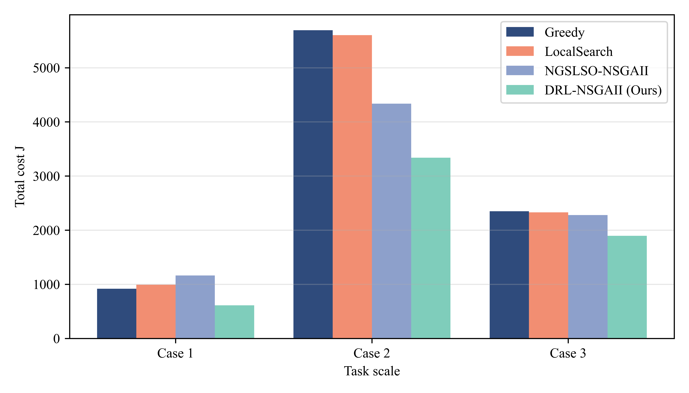
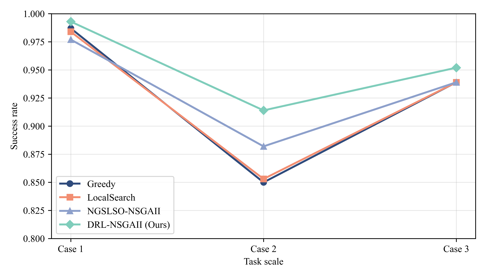
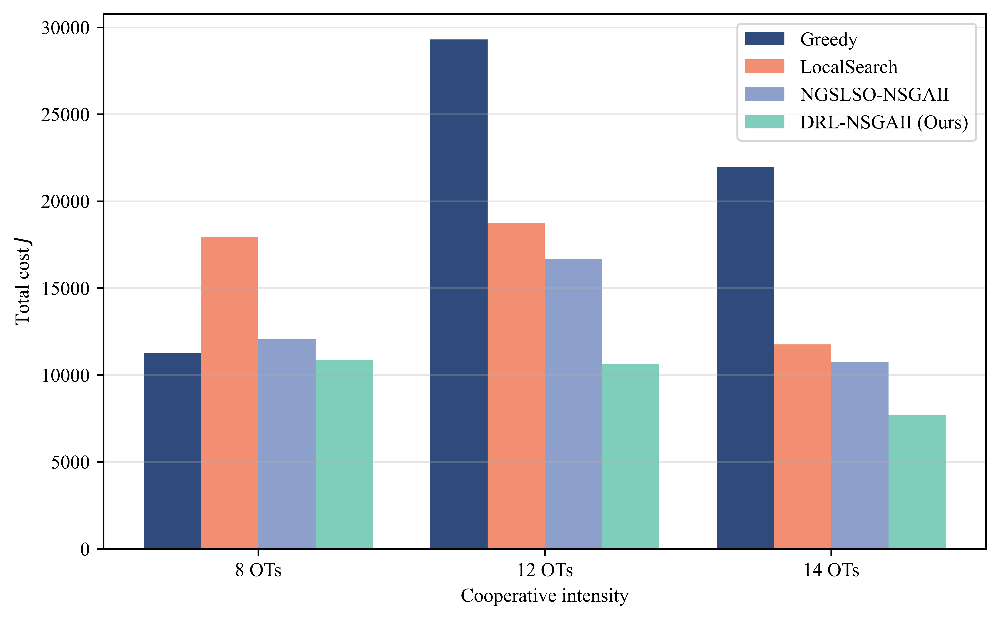
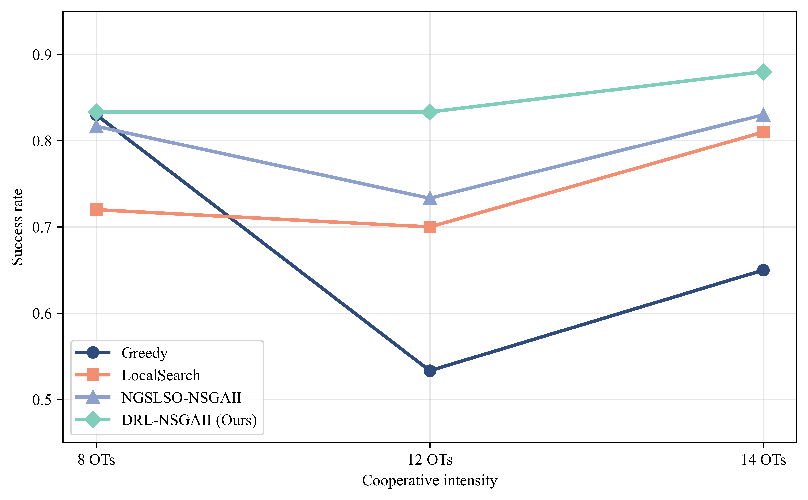
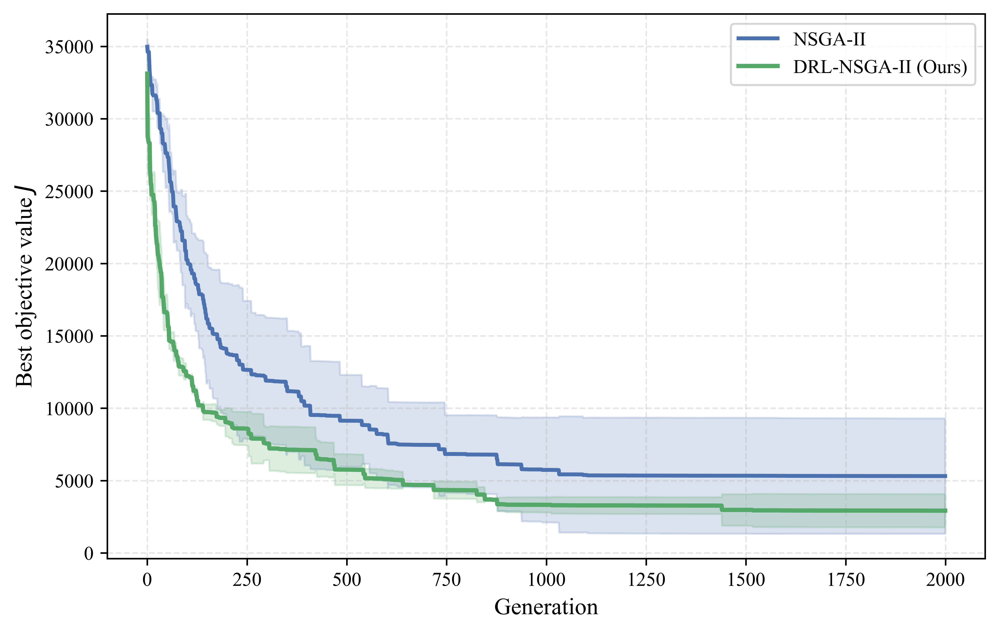
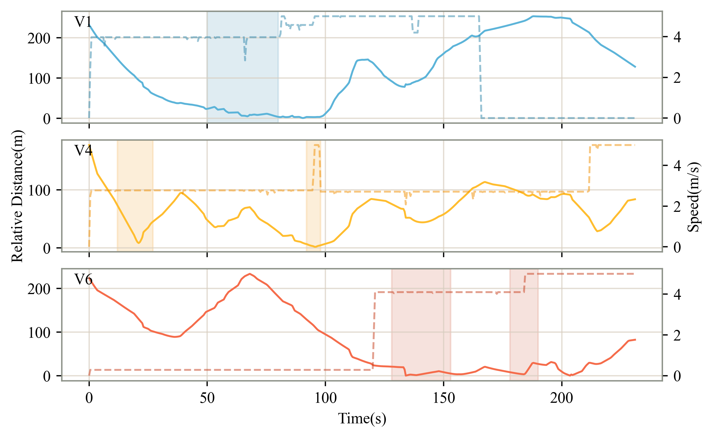
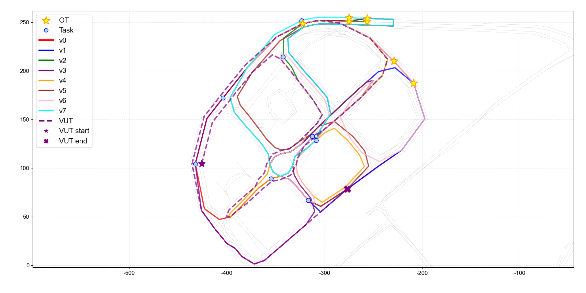

# Constraint-Aware Deep Reinforcement Learning-Guided Cooperative Scheduling Optimization Framework for Closed-Track Testing

---

### Core Problem

Closed-track automated driving testing is evolving from isolated scenario execution toward continuous scenario-flow testing. Under this new paradigm, a limited number of controllable object targets (OTs) are required to be dynamically scheduled and cooperatively deployed to generate sequential and interactive traffic events around the vehicle under test (VUT). This introduces a challenging scheduling problem:

- OTs must be assigned to heterogeneous testing tasks
- Routes must be planned within the constrained proving-ground road network
- Operations must be synchronized with strict trigger times determined by the motion of the VUT
- Cooperative events require multiple OTs to arrive at different staging points within an extremely narrow temporal tolerance
  **The core challenge lies in the strong coupling between testing semantics and execution constraints, which leads to a highly sparse feasible solution space.**

---

### Basic Functions

- Transform continuous scenario-flow testing events into executable OT task units (with time windows, service durations, staging points, and synchronization group labels)
- Construct the CMAPP (Cooperative Multi-task Assignment and Path Planning) problem model
- Design a constraint-aware deep reinforcement learning module to learn a feasibility-oriented scheduling distribution
- Inject high-quality individuals sampled from the DRL policy into the NSGA-II initial population
- Perform multi-objective Pareto optimization based on task failure count, makespan, workload imbalance, and total travel distance

---

### Code Structure

src/  
├── core/  
│ ├── config.py # Experiment configuration, data classes (Task/Vehicle/Solution)  
│ ├── decode.py # Chromosome → scheduling record decoding  
│ ├── encoding.py # Chromosome encoding, genetic operators (OX/Uniform/Insertion/Reset)  
├── rl/  
│ ├── drl_policy.py # Policy network (TaskPolicyNet)  
│ ├── drl_env.py # Environment interaction, reward function (R_tw + R_sync)  
│ └── drl_trainer.py # REINFORCE trainer  
└── ea/  
├── nsga2_solver.py # NSGA-II solver  
├── nsgaii.py # NSGA-II baseline (real-valued encoding version)  
└── drl_nsgaii_solver.py # DRL-NSGA-II hybrid solver

---

## Basic Prerequisites

- Python 3.8+
- PyTorch
- NetworkX
- NumPy / Pandas
- Matplotlib

---

### Code Description

- `core/encoding.py`: Chromosome encoding (PO layer + VS layer), implementing Order Crossover, Uniform Crossover, Insertion Mutation, and Reset Mutation
- `rl/drl_env.py`: DRL environment simulation + reward function. Reward = time-window reward + synchronization reward
- `rl/drl_trainer.py`: REINFORCE algorithm for training the policy network, producing elite individuals for population initialization
- `ea/nsga2_solver.py`: NSGA-II main loop, including non-dominated sorting, crowding distance computation, and tournament selection
- `ea/drl_nsgaii_solver.py`: Hybrid solver that first trains the DRL policy, then uses DRL-sampled solutions to initialize NSGA-II

---

### Experimental Results

#### Performance under Different Task Scales

The following figure presents the overall scheduling cost \( J \) under three task-scale settings (Case 1–3). The proposed DRL-NSGA-II consistently achieves the lowest cost across all cases, with the performance gap becoming more pronounced as task scale increases.

The corresponding task success rates are shown below. DRL-NSGA-II maintains the highest success rates across all cases, particularly in Case 2, which represents the most challenging setting.

#### Performance under Different Cooperative Intensities

To evaluate the robustness of the proposed method under varying synchronization constraints, experiments are conducted with 8, 12, and 14 OTs. The overall scheduling cost \( J \) under different cooperative intensities is shown below. DRL-NSGA-II consistently outperforms all baselines, with the advantage becoming more significant under higher cooperative intensity.

The corresponding task success rates are illustrated below. The proposed method maintains consistently higher success rates across all settings, demonstrating its strong capability in handling feasibility-constrained scheduling under high interaction density.

#### Convergence Analysis

The convergence behavior of NSGA-II and DRL-NSGA-II is compared in the figure below. DRL-NSGA-II achieves significantly faster convergence and more stable optimization trajectories, reaching lower objective values in early generations and maintaining a consistently lower convergence curve throughout the optimization process.

#### Visualization and Case Study

The following animation illustrates a vehicle scheduling simulation for a 10-task instance. Multiple OTs are dynamically assigned and routed to staging points while the VUT moves along its reference trajectory. The visualization demonstrates the temporal coordination and spatial distribution of the cooperative schedule.

The speed and relative distance profiles of representative OTs during cooperative task execution are shown below. The speed curves remain smooth throughout the execution process, and the corresponding relative distances vary continuously without abnormal fluctuations, confirming that the generated trajectories satisfy motion feasibility requirements.

The figure below presents the resulting cooperative scheduling solution on a real-world closed-track map. The generated schedule enables multiple OTs to reach their assigned staging points in an organized manner while maintaining the required coordination relationships with the VUT route, validating the practical deployability of the proposed framework.

---

### Discussion and Reflections

- **Reward Function Design**: The constraint-aware reward \( R = R_{tw} + R_{sync} \) proposed in this paper unifies time-window and synchronization constraints under a common scale, avoiding the sensitivity issues associated with multi-objective weighting. After normalization, the reward values remain within a controllable range, facilitating stable convergence of the policy network.

- **Complementarity of DRL and NSGA-II**: Relying solely on DRL tends to converge to a single strategy, while pure NSGA-II incurs prohibitively high evaluation costs in sparse feasible regions. This paper adopts a layered strategy—"DRL learns the feasibility distribution + EA performs Pareto refinement"—which reduces the task failure rate from 1% to 0 under the 60-25 setting.

- **On Module Replaceability**: The DRL policy network in this paper employs the REINFORCE algorithm. However, in practice, this module can be replaced by more sophisticated algorithms such as PPO or A2C. This is analogous to the role of the GHF solver in geodesic path planning—the core idea remains unified, while the specific implementation can be flexibly substituted.

- **On Decoder Sharing**: Individuals sampled by the DRL and those randomly initialized are evaluated using the same decoder within NSGA-II, ensuring consistency in evaluation. This allows the "feasibility awareness" learned by the DRL to directly serve the subsequent evolutionary search without requiring additional adaptation.

- **Limitations**: The current scheduling model primarily relies on network-level travel time estimation and does not fully incorporate detailed vehicle dynamics or low-level trajectory tracking constraints. Future work will focus on integrating kinodynamic feasibility into the scheduling model, as well as developing online rolling scheduling strategies under VUT arrival time deviations and temporary OT unavailability.

---

<b>点击查看中文版</b>

# 约束感知深度强化学习引导的封闭赛道协同调度优化框架

---

### 核心问题

封闭赛道自动驾驶测试正从单一场景执行向连续场景流测试演进。在此新范式下，有限数量的可控目标物体（OTs）需要被动态调度并协同部署，以在测试车辆（VUT）周围生成连续的交互式交通事件。这引入了一个复杂的调度问题：

- OTs 必须被分配给异构的测试任务
- 在受限的试车场路网中规划路径
- 与由 VUT 运动决定的严格触发时间保持同步
- 协同事件要求多个 OTs 在极窄的时间容差内到达不同 staging 点

**核心挑战在于：测试语义与执行约束之间的强耦合，导致可行解空间高度稀疏。**

---

### 基本功能

- 将连续场景流测试事件转化为可执行的 OT 任务单元（含时间窗、服务时长、staging 点、协同组标签）
- 构建 CMAPP（Cooperative Multi-task Assignment and Path Planning）问题模型
- 设计约束感知的深度强化学习模块，学习可行性导向的调度分布
- 将 DRL 策略采样的高质量个体注入 NSGA-II 初始种群
- 基于任务失败数、makespan、负载均衡、总行驶距离进行多目标 Pareto优化
src/
├── core/
│ ├── config.py # 实验配置、数据类（Task/Vehicle/Solution）
│ ├── decode.py # 染色体 → 调度记录解码
│ ├── encoding.py # 染色体编码、遗传算子（OX/Uniform/Insertion/Reset）
├── rl/
│ ├── drl_policy.py # 策略网络（TaskPolicyNet）
│ ├── drl_env.py # 环境交互、奖励函数（R_tw + R_sync）
│ └── drl_trainer.py # REINFORCE 训练器
└── ea/
├── nsga2_solver.py # NSGA-II 求解器
├── nsgaii.py # NSGA-II 基线（实数编码版本）
└── drl_nsgaii_solver.py # DRL-NSGA-II 混合求解器
---

### 基本前置

- Python 3.8+
- PyTorch
- NetworkX
- NumPy / Pandas
- Matplotlib

---

### 代码说明

- `core/encoding.py`：染色体编码（PO 层 + VS 层），实现 Order Crossover、Uniform Crossover、Insertion Mutation、Reset Mutation
- `rl/drl_env.py`：DRL 环境模拟 + 奖励函数。奖励 = 时间窗奖励 + 协同同步奖励
- `rl/drl_trainer.py`：REINFORCE 算法训练策略网络，输出可用于初始种群的精英个体
- `ea/nsga2_solver.py`：NSGA-II 主循环，包含非支配排序、拥挤距离、锦标赛选择
- `ea/drl_nsgaii_solver.py`：混合求解器，先训练 DRL，再用 DRL 采样初始化 NSGA-II

---

### 实验结果

#### 不同任务规模下的性能表现

下图展示了三种任务规模设置（Case 1–3）下的综合调度成本 \( J \)。所提 DRL-NSGA-II 在所有情况下均取得最低成本，且随着任务规模增大，性能优势更加明显。

对应的任务成功率如下图所示。DRL-NSGA-II 在所有情况下均保持最高的成功率，尤其在最具挑战性的 Case 2 中表现突出。

#### 不同协同强度下的性能表现

为评估所提方法在不同同步约束下的鲁棒性，进行了 8、12、14 个 OT 的实验。下图展示了不同协同强度下的综合调度成本 \( J \)。DRL-NSGA-II 在所有情况下均优于基线方法，且在高协同强度下优势更为显著。

对应的任务成功率如下图所示。所提方法在所有设置下均保持更高的成功率，证明了其在强交互密度下处理可行性约束调度的能力。

#### 收敛性分析

下图为 NSGA-II 与 DRL-NSGA-II 的收敛曲线对比。DRL-NSGA-II 收敛速度显著更快，优化轨迹更稳定，在早期代数即达到更低的目标准则值，并在整个优化过程中保持更低的收敛曲线。

#### 可视化与实景案例

下图展示了 10 任务场景下的车辆调度仿真动画。多台 OT 被动态分配并路由至 staging 点，同时 VUT 沿参考轨迹运动。该可视化展示了协同调度的时间协调性和空间分布。

下图为协同任务执行过程中代表性 OT 的速度和相对距离曲线。速度曲线在整个执行过程中保持平滑，相对距离连续变化且无异常波动，验证了生成轨迹的运动学可行性。

下图展示了在实景封闭赛道地图上的协同调度结果。生成的调度使多台 OT 能够以有序方式到达指定的 staging 点，同时保持与 VUT 路径所需的协同关系，验证了所提框架的实际部署可行性。

---

### 讨论与思考

- **奖励函数设计**：本文提出的约束感知奖励 \( R = R_{tw} + R_{sync} \) 将时间窗和协同同步统一到同一尺度，避免了多目标加权带来的敏感性问题。归一化处理后奖励值稳定在可控范围内，有利于策略网络的稳定收敛。

- **DRL + NSGA-II 的互补性**：单纯依赖 DRL 容易陷入单一策略，而纯 NSGA-II 在稀疏可行解区域评估成本过高。本文采用“DRL 学可行性分布 + EA 做 Pareto 精炼”的分层策略，在 60-25 规模下任务失败率从 1% 降至 0。

- **关于模块替换**：本文的 DRL 策略网络采用的是 REINFORCE 算法，但在实际实现中，该模块可以被 PPO、A2C 等更复杂的算法替代。GHF 求解器在测地线路径规划中的角色类似——核心思想是统一的，具体实现可灵活替换。

- **关于解码器共享**：DRL 采样的个体和随机初始化的个体在 NSGA-II 中使用同一个解码器评估，保证了评估的一致性。这使得 DRL 学到的“可行性感知”能够直接服务于后续的进化搜索，而不需要额外的适配。

- **局限性**：目前的调度模型主要基于路网级别的行程时间估计，未嵌入详细的车辆动力学和底层轨迹跟踪约束。未来工作将考虑将运动学可行性集成到调度模型中，并在 VUT 到达时间偏差和 OT 临时不可用等场景下开发在线滚动调度策略。

