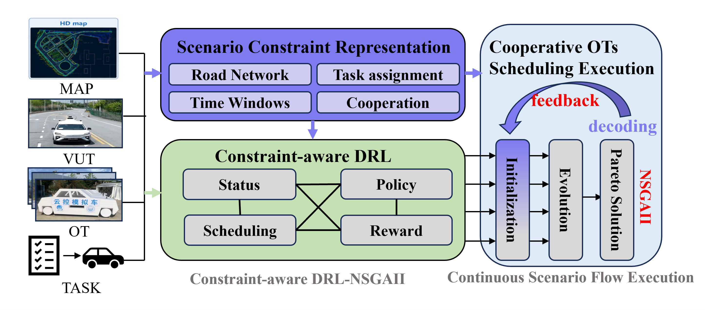
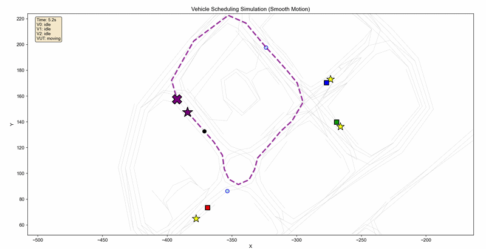
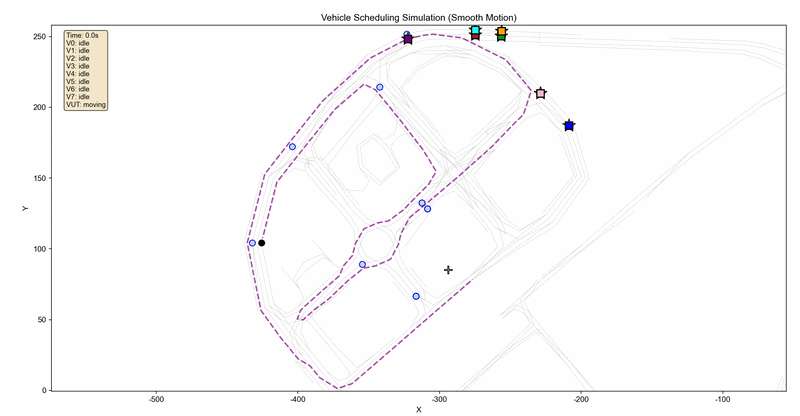

# Constraint-Aware Deep Reinforcement Learning-Guided Cooperative Scheduling Optimization Framework for Closed-Track Testing

---

Closed-track testing evolves from isolated scenarios to continuous scenario flows, requiring dynamic cooperative deployment of limited controllable targets to generate sequential interactive events. This problem faces multiple coupled constraints including task assignment, network routing, and temporal synchronization, yielding a highly sparse feasible space. We propose a constraint-aware hybrid framework integrating DRL with NSGA-II. DRL learns a feasibility-oriented scheduling distribution with time-window deviation and synchronization error as rewards, producing high-quality initial individuals, while NSGA-II performs Pareto refinement over task failure count, makespan, workload imbalance, and travel distance. A two-layer chromosome encoding with tailored genetic operators and a unified decoder ensure consistent evaluation. Simulations on 60 tasks with 25 targets show the hybrid strategy reduces the failure rate from 1% to 0%, confirming the layered design where DRL learns feasible distributions and EA conducts Pareto optimization.

## 1. Framework

### 1.1 Problem Formulation

Closed-track automated driving testing is evolving from isolated scenario execution toward continuous scenario-flow testing, where a limited number of controllable object targets (OTs) must be dynamically scheduled and cooperatively deployed to generate sequential and interactive traffic events around the vehicle under test (VUT). This paradigm shift introduces a challenging scheduling problem with multiple coupled constraints: OTs must be assigned to heterogeneous testing tasks, routed through a constrained proving-ground network, and synchronized with strict trigger times dictated by VUT motion. Cooperative events further require multiple OTs to arrive at distinct staging points within an extremely narrow temporal tolerance. The core challenge lies in the strong coupling between testing semantics and execution constraints, which renders the feasible solution space highly sparse.

### 1.2 Scenario-to-Task Transformation

As illustrated in Fig. 1, a continuous scenario flow comprises a temporally ordered sequence of scenes, each representing a relatively stable traffic state and characterized by a set of key events. These events are triggered by state transitions of traffic participants—including vehicles, pedestrians, and infrastructure elements—revealing the hierarchical and decomposable nature of testing scenarios. To render each scenario executable by OTs, every testing event is transformed into one or more task units, each defined by a time window, service duration, staging point, and synchronization group label.

**Figure 1:** Hierarchical representation of event-driven testing scenarios and their transformation into executable OT task units.

### 1.3 Algorithm Overview

The proposed framework operates in two complementary stages, as depicted in Fig. 2. In the first stage, a deep reinforcement learning (DRL) module learns a feasibility-oriented scheduling distribution. The policy network sequentially determines task priorities and OT assignments, receiving continuous feedback from time-window violations and synchronization errors. Rather than serving as a standalone scheduler, the learned policy is used to generate high-quality and diverse initial individuals. In the second stage, NSGA-II performs Pareto-based refinement over four testing-oriented objectives: task failure count, global makespan, workload imbalance, and total travel distance.

The underlying principle is to decouple constraint feasibility learning from multi-objective Pareto search: the DRL module guides the search toward promising feasible regions, while NSGA-II maintains population diversity and explores trade-off solutions.

**Figure 2:** Overall architecture of the constraint-aware DRL-guided NSGA-II framework, including state representation, policy network, constraint-aware reward design, chromosome encoding, and population update.

### 1.4 Chromosome Representation and Genetic Operators

Each individual is encoded as a two-layer chromosome:

$$\chi = (\pi, \mathbf{v})$$

- **PO layer** ($\pi$): a permutation of all task units, determining the global decoding order.
- **VS layer** ($\mathbf{v}$): specifies the OT assigned to each task unit.

The genetic operators are strictly defined as follows:

- PO-layer crossover: Order Crossover (OX)
- VS-layer crossover: Uniform Crossover
- PO-layer mutation: Insertion Mutation
- VS-layer mutation: Reset Mutation

---

## 2. Code Usage

### 2.1 Code Structure

src/  
├── core/  
│ ├── config.py # Experiment configuration and data classes (Task/Vehicle/Solution)  
│ ├── decode.py # Chromosome-to-schedule decoding  
│ ├── encoding.py # Chromosome encoding and genetic operators 
├── rl/  
│ ├── drl_policy.py # Policy network (TaskPolicyNet)  
│ ├── drl_env.py # Environment interaction and reward function (R_tw + R_sync)  
│ └── drl_trainer.py # REINFORCE trainer  
└── ea/  
├── nsga2_solver.py # NSGA-II solver  
├── nsgaii.py # NSGA-II baseline (real-valued encoding)  
└── drl_nsgaii_solver.py # DRL-NSGA-II hybrid solver

### 2.2 Prerequisites

- Python 3.8+
- PyTorch
- NetworkX
- NumPy / Pandas
- Matplotlib

### 2.3 Key Modules

- `core/encoding.py`: Implements two-layer chromosome encoding and the corresponding genetic operators: Order Crossover, Uniform Crossover, Insertion Mutation, and Reset Mutation.
- `rl/drl_env.py`: Simulates the scheduling environment and computes the constraint-aware reward, defined as the sum of time-window reward and synchronization reward.
- `rl/drl_trainer.py`: Trains the policy network using the REINFORCE algorithm and generates elite individuals for population initialization.
- `ea/nsga2_solver.py`: Implements the main NSGA-II loop, including non-dominated sorting, crowding distance computation, and tournament selection.
- `ea/drl_nsgaii_solver.py`: Hybrid solver that first trains the DRL policy and then uses the sampled solutions to initialize the NSGA-II population.

### 2.4 Reward Function

The constraint-aware reward is defined as:

$R = R_{tw} + R_{sync}$

where:

- $R_{tw} = -\frac{1}{|I|}\sum_{i \in I} e_i^{tw}$ penalizes both early and late arrivals with respect to task-specific time windows.
- $R_{sync} = -\frac{1}{|C|}\sum_{s \in C} e_s^{sync}$ penalizes synchronization deviations among OTs assigned to the same cooperative event.

This reward design ensures that the DRL module learns scheduling patterns that satisfy both task-level temporal constraints and group-level coordination requirements.

---

## 3. Results and Demonstration

To further validate the scalability and interpretability of the proposed framework, we first conduct a small-scale experiment with 4 OTs. In this setting, the scheduling horizon is relatively short, and the synchronization requirements are moderate. As shown in Fig. 3(a), the DRL-guided policy efficiently assigns the 4 OTs to their respective staging points with near-zero synchronization errors. The simplified interaction among OTs allows the NSGA-II refinement to converge rapidly, producing a Pareto front that simultaneously minimizes makespan and travel distance. This 4-task case serves as a sanity check, confirming that the constraint-aware reward mechanism functions correctly before scaling to more complex instances.

**Figure 3(a):** Simulation of cooperative OT scheduling for a 4-task instance, demonstrating rapid convergence and precise synchronization under low coupling.

Subsequently, we scale up to a more representative 10-task instance to examine the framework's performance under increased task density and tighter coupling. Multiple OTs are dynamically assigned and routed to their respective staging points while the VUT proceeds along its reference trajectory. The following animation clearly captures the temporal coordination and spatial distribution of the cooperative schedule, demonstrating the framework's ability to generate executable and well-synchronized task plans in a realistic closed-track setting.

**Figure 3(b):** Simulation of cooperative OT scheduling for a 10-task instance. Each OT is color-coded, and the VUT trajectory is shown in red.

Together, these two cases—ranging from simple to moderately complex—illustrate the robustness of the proposed DRL-NSGA-II hybrid framework across different problem scales.

---

### 4.Discussion and Reflections

- **Reward Function Design**: The constraint-aware reward $R = R_{tw} + R_{sync}$ unifies time-window and synchronization constraints under a common scale, circumventing the sensitivity issues commonly associated with multi-objective weighting. Normalization keeps the reward values within a stable range, facilitating smooth convergence of the policy network.

- **Complementarity of DRL and NSGA-II**: A DRL-only approach tends to converge to a single strategy, while vanilla NSGA-II incurs prohibitive evaluation costs in sparse feasible regions. The proposed layered strategy—"DRL learns the feasibility distribution + EA performs Pareto refinement"—reduces the task failure rate from 1% to 0 under the 60-task, 25-OT setting.

- **Module Replaceability**: Although the current implementation employs the REINFORCE algorithm, the DRL module can be readily substituted with more advanced algorithms such as PPO or A2C. The core idea remains intact while the implementation details remain flexible.

- **Decoder Sharing**: Both DRL-sampled individuals and randomly initialized individuals are evaluated using the same decoder within NSGA-II, ensuring consistent fitness assessment. This allows the feasibility awareness acquired by the DRL to directly benefit the subsequent evolutionary search without additional adaptation.

- **Limitations**: The current model relies primarily on network-level travel time estimation and does not fully incorporate vehicle dynamics or low-level trajectory tracking constraints. Future work will integrate kinodynamic feasibility into the scheduling model and develop online rolling scheduling strategies to handle VUT arrival deviations and temporary OT unavailability.
